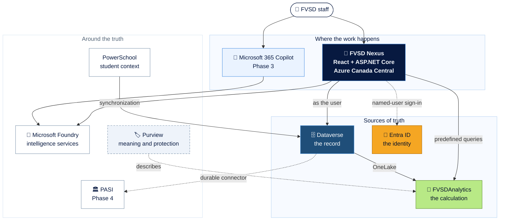
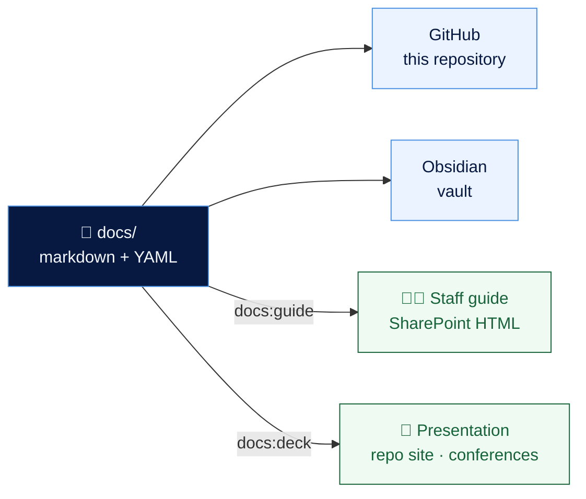

# 🏠 FVSD Nexus Documentation

> Governed, role-aware software that moves Fort Vermilion School Division from evidence to action, documented once, read everywhere.

[⬅️ Repository](../README.md) · [📖 Philosophy](philosophy/README.md) · [🏗️ Architecture](architecture/README.md) · [🧩 Capabilities](capabilities/README.md) · [🧑‍🏫 Staff guide](user-guide/README.md) · [🎤 Presentation](presentation/README.md)

---

## 🧭 Overview

**FVSD Nexus** is the division's unified operational and analytics application: an Azure-hosted React and ASP.NET Core app that reads governed measures from Fabric, keeps operational records in Dataverse, and lets every person act as themselves. This folder is its living product, architecture, governance and delivery record, and the single source for the staff guide and conference presentation.

| Characteristic | What it means |
|---|---|
| 🗄️ **Three sources of truth** | Records live in Dataverse, calculations in the semantic model, identity in Entra. Nexus is never a fourth. |
| 🎯 **The app asks, never answers** | Only predefined, reviewed queries reach the semantic model; scores are derived, never typed. |
| 🔐 **Named-user access** | Every read and write runs with the signed-in person's own permissions. |
| 🍁 **Canadian residency** | Identifiable student information stays in the approved Canadian geography. |
| 🔄 **Vertical slices** | Each capability is built end to end on real identity before the next begins. |
| 📝 **Honest status** | Every page and capability says whether it is current, confirmed, proposed or open. |

## 👥 Who this is for

| Reader | Start with |
|---|---|
| Division leadership and trustees | [Philosophy](philosophy/README.md), [capabilities](capabilities/README.md), [phased delivery plan](delivery/roadmap.md) |
| Architects and data leaders | [Architecture overview](architecture/overview.md), [governance framework](governance/README.md), [decision records](decisions/adr/README.md) |
| Developers | [Architecture](architecture/README.md), [design system](design-system/README.md), [testing strategy](delivery/testing-strategy.md), [contributing](CONTRIBUTING.md) |
| Staff and school administrators | The published **staff user guide** (source: [user-guide](user-guide/README.md)) |
| Presenters and conference audiences | [Presentation layer](presentation/README.md) |

## 🏗️ System at a glance



The full component view, including the agent and governance services, is in the [architecture overview](architecture/overview.md).

## 🧩 Capabilities

| Capability | Status | Documentation | Staff guide |
|---|---|---|---|
| 📊 Leadership analytics | 🟢 **Current** | [Leadership analytics](capabilities/leadership-analytics/README.md) | [Chapter 2](user-guide/02-leadership-analytics.md) |
| 🏫 Class Assignments | 🟢 **Current** | [Assessment entry and scoring](capabilities/assessments/README.md) | [Chapter 3](user-guide/03-class-assignments.md) |
| 📋 Assessment entry and completion | 🟢 **Partial** — TOSREC | [Assessment entry and scoring](capabilities/assessments/README.md) | [Chapter 4](user-guide/04-assessments.md) |
| 🎓 IEP / IPP annual plans | 🔵 **Active build** | [IEP / IPP](capabilities/ipp/README.md) | [Chapter 5](user-guide/05-iep-ipp.md) |
| 🩺 Intervention tracking | 🔵 **Phase 1–2** | [Interventions](capabilities/interventions/README.md) | Within chapter 5 |
| 🪪 School and student profiles | 🟠 **Proposed** | [Profiles](capabilities/profiles/README.md) | — |
| 🛡️ Purview governance and Data Analyst workspace | 🔵 **Phase 3** | [Purview governance](capabilities/purview-governance/README.md) | — |
| 🤖 Microsoft 365 Copilot integration | 🔵 **Phase 3** | [Copilot interoperability](architecture/copilot-interoperability.md) | — |
| 🏛️ PASI provincial connector | 🔵 **Phase 4** | [PASI connector](capabilities/pasi-connector/README.md) | — |
| ⚙️ Platform administration | 🟢 **Partial** | [Administration](capabilities/administration/README.md) | [Chapter 6](user-guide/06-settings-and-support.md) |

## 📌 Status labels

Every page and capability declares one of these states, in its front matter and in its opening lines.

| Marker | Status | Meaning |
|---|---|---|
| 🟢 | **Current** | Implemented and available in the active Nexus build. |
| 🔵 | **Confirmed** | Agreed premise, constraint or scheduled work that guides implementation. |
| 🟠 | **Proposed** | Intended direction that still requires Leadership approval or detailed design. |
| ⚪ | **Open** | A decision, dependency or requirement that has not been resolved. |

## 🔄 One source, four surfaces



Write once in `docs/`. GitHub and Obsidian read it in place; `tools/docs` builds the staff guide and the deck into `publish/`. How this works is set out in the [documentation standards](standards/README.md).

## 🗺️ Documentation map

```text
docs/
├── 🏠 README.md                       ← You are here
├── 📝 CONTRIBUTING.md                 ← How to change docs, build outputs, check links
│
├── 📖 philosophy/                     ← Why Nexus is built this way
├── 🛡️ governance/                     ← Privacy, residency, integrity and audit controls
├── 🏗️ architecture/                   ← System design, integrations, identity, residency
├── 🧩 capabilities/                   ← One landing page per product capability
├── ⚖️ decisions/                      ← Decision register and ADR-0001 … ADR-0007
├── 🚀 delivery/                       ← Roadmap, Phase 1 build, adoption, testing
├── 🎨 design-system/                  ← Foundations, components, layouts, responsive rules
├── 📚 reference/                      ← Glossary and external reference indexes
│
├── 🧑‍🏫 user-guide/                     ← Staff guide source → publish/user-guide/
├── 🎤 presentation/                   ← Deck sources → publish/presentation/
└── 📐 standards/                      ← Brand, icons, front matter, diagrams, templates
```

## 🔗 Quick navigation

| Topic | Link |
|---|---|
| 📖 Philosophy and design rationale | [philosophy/README.md](philosophy/README.md) |
| 🛡️ Governance framework | [governance/README.md](governance/README.md) |
| 🏗️ Architecture overview | [architecture/overview.md](architecture/overview.md) |
| 🔌 Data and integrations | [architecture/data-and-integrations.md](architecture/data-and-integrations.md) |
| 🔐 Identity, licensing and security | [architecture/identity-licensing-security.md](architecture/identity-licensing-security.md) |
| 🍁 Residency and platform options | [architecture/residency-and-platform-options.md](architecture/residency-and-platform-options.md) |
| 🤖 Copilot and agent interoperability | [architecture/copilot-interoperability.md](architecture/copilot-interoperability.md) |
| 📄 App-native document generation | [architecture/document-generation.md](architecture/document-generation.md) |
| ⚖️ Decision register | [decisions/decision-register.md](decisions/decision-register.md) |
| ⚖️ Architecture decision records | [decisions/adr/README.md](decisions/adr/README.md) |
| 🚀 Phased delivery plan | [delivery/roadmap.md](delivery/roadmap.md) |
| 🧪 Testing strategy | [delivery/testing-strategy.md](delivery/testing-strategy.md) |
| 🎨 Design system | [design-system/README.md](design-system/README.md) |
| 📚 Glossary | [reference/glossary.md](reference/glossary.md) |
| 🧑‍🏫 Staff user guide source | [user-guide/README.md](user-guide/README.md) |
| 🎤 Presentation layer | [presentation/README.md](presentation/README.md) |
| 📐 Documentation standards | [standards/README.md](standards/README.md) |

## 🧩 Portable patterns

Nexus is built for FVSD, but these patterns travel to any Microsoft 365 organization:

- **Name your sources of truth, then defend them.** Record, calculation, identity. Every architecture decision becomes a test against three lines.
- **Build vertical slices, not prototypes.** One narrow journey built completely earns more trust than a broad demo.
- **Extract documentation from the system.** Anything written separately is already drifting; generate guides and decks from one source.
- **Separate deciding from writing.** No component both makes a judgement and commits it.
- **Treat residency as a boundary.** Decide what never leaves the country before choosing tools.

Related work: the [FVSD Data Product Agent](https://github.com/skmckenFVSD/FVSDDataProductAgent) governs the lifecycle of the measures Nexus displays.

---

*🏫 FVSD Nexus · Fort Vermilion School Division · Documentation*
