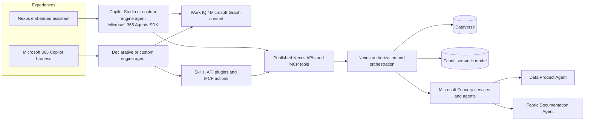

# Copilot and agent interoperability

> [FVSD Nexus](../../README.md) / [Documentation](../README.md) / [Architecture](README.md) / Copilot interoperability

**Status:** Phase 3 architecture and capability investigation

## Objective

FVSD staff should be able to reach the same governed Nexus capabilities from two places:

1. a Copilot experience embedded within the Nexus application; and
2. the Microsoft 365 Copilot harness used across Microsoft 365.

These are two user experiences over the same published service contracts. They must not develop separate business rules, permissions, or definitions.

## Current Microsoft extension choices

Microsoft uses overlapping terms across its extension models. Nexus should select each component by responsibility rather than assuming they are interchangeable.

| Component | Nexus use | Boundary to retain |
|---|---|---|
| Declarative agent | Named experience inside Microsoft 365 Copilot using the Microsoft-managed orchestrator. | Configuration, knowledge, skills, actions, and supported hosts determine what it can do. |
| Custom engine agent | Use when FVSD must control orchestration, models, hosting, or runtime through Foundry, Copilot Studio, or the Microsoft 365 Agents SDK. | FVSD owns more security, evaluation, hosting, and operational responsibility. |
| Skill | Reusable instruction or workflow capability attached through a supported plugin/agent model. | Availability and packaging can vary by authoring tool, host, licence, and preview status. |
| API plugin/action | A typed REST operation exposed to a declarative agent through an OpenAPI contract. | It is an action within an approved agent, not a replacement for Nexus API authorization. |
| MCP plugin/tool | A dynamically or explicitly selected tool exposed through a governed MCP server. | Tool discovery, authentication, administration, versioning, and least privilege must be controlled. |
| Work IQ | Permission-aware Microsoft 365 work context for supported applications and agents. | It does not grant Dataverse, Fabric, Purview, or Nexus rights. |
| Copilot connector | Makes approved external organizational content discoverable through Microsoft Graph and Copilot experiences. | It replicates/indexes content and is not the preferred route for live operational transactions. |

## Recommended Nexus pattern

### Shared capability plane

Nexus should expose a small catalogue of typed capabilities through its ASP.NET Core service boundary. A capability may be published as REST/OpenAPI, MCP, or both when Microsoft host support and the security model justify it.

Initial read-oriented candidates include:

- explain a governed Fabric measure or data product;
- retrieve an authorized completion summary;
- retrieve an authorized student's current plan status;
- find the definition, owner, freshness, and lineage for an approved analytical object;
- prepare, but not silently commit, a governed registration or review request.

Write-oriented capabilities require deterministic validation, destination authorization, an idempotency key, an audit correlation identifier, and the same confirmation expected in Nexus.

### Embedded within Nexus

The preferred investigation path is a published Copilot Studio or custom engine agent integrated into the Nexus React experience with the Microsoft 365 Agents SDK and interactive Entra sign-in. This provides a controllable side-panel experience without configuring an anonymous iframe.

The embedded agent should receive only the minimum explicit Nexus context needed for the current task, such as the active school, class, student, plan, or assessment identifier. The API must independently reauthorize every identifier.

### Inside Microsoft 365 Copilot

Package an FVSD Nexus agent/plugin for the Microsoft 365 Copilot harness. A declarative agent can use approved skills, REST actions, and MCP tools; a custom engine agent remains available where FVSD needs its own Foundry orchestration.

The agent should return deep links into the precise Nexus context when a task needs structured entry, document review, or another interaction better handled by the application.

### Work IQ

Use Work IQ only for appropriate Microsoft 365 work context, such as authorized files, meetings, messages, people, or organizational knowledge. Do not copy student operational truth into prompts merely because it is available elsewhere in Microsoft 365. Dataverse and Fabric remain authoritative and are queried through their governed Nexus contracts.

## Security and governance requirements

- Interactive access uses the signed-in person's Entra identity wherever the selected host supports delegated user context.
- The plugin, agent, API, MCP server, and destination each enforce their own applicable permission boundary.
- No agent receives a general Dataverse client, arbitrary DAX, or unrestricted student lookup tool.
- Read and write tools are separated; consequential writes require confirmation and audit.
- Tool descriptions must state scope, side effects, data classification, and expected confirmation behaviour.
- MCP servers, plugins, skills, agents, connections, and publishing assignments require named owners and an administrative lifecycle.
- Prompt, response, and tool telemetry must minimize student-identifiable content and follow the approved Canadian processing boundary.

## Investigation sequence

1. Inventory current Microsoft 365 Copilot, Copilot Studio, Work IQ, Foundry, Agents SDK, plugin, and MCP licensing and tenant availability.
2. Select one read-only Nexus capability and publish it through a typed REST action.
3. Validate the capability in a Microsoft 365 Copilot declarative agent.
4. Integrate the same capability into a Nexus side panel using the Agents SDK and Entra sign-in.
5. Add Work IQ context to an approved, non-student-sensitive scenario and confirm permission trimming.
6. Compare API plugin and MCP packaging, discovery, administration, latency, traceability, and support.
7. Add one confirmation-based write only after the read path, audit correlation, and failure behaviour are accepted.

## Acceptance evidence

- The same user receives the same authorization outcome from Nexus and Microsoft 365 Copilot.
- Context supplied by either harness cannot expand the user's school, class, student, or data-product scope.
- Tool selection and outputs are traceable without logging sensitive payloads.
- Unavailable Work IQ, Foundry, or Copilot services do not prevent ordinary Nexus workflows.
- Users can distinguish an explanation, a prepared action, and a completed transaction.
- Administrators can identify the owner, version, deployment scope, permissions, and status of every agent, skill, plugin, and MCP server.

## Microsoft references

- [Ways to extend Microsoft 365 Copilot](https://learn.microsoft.com/en-us/microsoft-365/copilot/extensibility/overview)
- [Declarative agents for Microsoft 365 Copilot](https://learn.microsoft.com/en-us/microsoft-365-copilot/extensibility/overview-declarative-agent)
- [MCP and API plugins for declarative agents](https://learn.microsoft.com/en-us/microsoft-365/copilot/extensibility/overview-plugins)
- [Integrate web or native apps with the Microsoft 365 Agents SDK](https://learn.microsoft.com/en-us/microsoft-copilot-studio/publication-integrate-web-or-native-app-m365-agents-sdk)
- [Work IQ overview](https://learn.microsoft.com/en-us/microsoft-365/copilot/extensibility/work-iq)
- [Microsoft Foundry Agent Service](https://learn.microsoft.com/en-us/azure/foundry/agents/overview)
