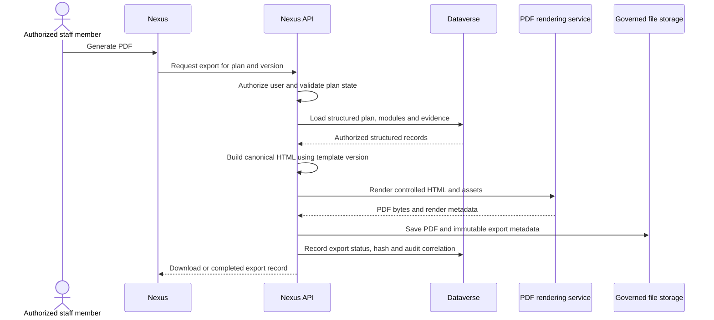

# App-native document and PDF generation

> [FVSD Nexus](../../README.md) / [Documentation](../README.md) / [Architecture](README.md) / Document generation

**Status:** Confirmed product requirement; Playwright rendering service recommended for a Phase 1 implementation spike

## Objective

Nexus will generate IEP/IPP and other governed PDFs directly from the application. The target flow removes the current Power Automate, OneDrive HTML-file, and OneDrive PDF-conversion dependency.

The PDF is an output derived from structured Dataverse records. Stored HTML is not the operational source of truth.

## Recommended architecture

Use a small internal document-rendering service built with ASP.NET Core, Playwright for .NET, and headless Chromium. Playwright's `Page.PdfAsync` produces a PDF byte array from controlled HTML and print CSS and supports page size, background, margins, and tagged-PDF options.

Run the renderer as an isolated Azure container rather than installing browser dependencies into the main Nexus App Service. Azure Container Apps is the leading deployment option because it supports custom containers, internal ingress, revisions, and HTTP/event-driven scaling. A custom-container App Service remains a viable alternative if operational simplicity with the existing hosting model is more important than isolation and independent scaling.

## Rendering contract

The renderer receives only a controlled request from the Nexus API:

- canonical HTML generated server-side from authorized structured records;
- an allow-listed template and template version;
- bundled fonts, FVSD assets, print CSS, page size, margins, headers, and footers;
- accessibility and output options;
- a correlation identifier and timeout.

It returns:

- PDF bytes;
- page count and render duration where available;
- renderer and template versions;
- warnings or a structured failure code.

The renderer must not accept a user-supplied URL, arbitrary remote assets, scripts, or unsanitized client HTML. Network access should be denied or allow-listed because the service is rendering trusted Nexus content, not browsing the internet.

## Export record

Each completed export should retain enough metadata to reproduce and defend the document:

- plan and student identifiers;
- school year and plan classification;
- source plan version or Dataverse row version;
- selected module definitions and display order;
- template and renderer version;
- generated-by identity and generated timestamp;
- PDF filename, content type, byte length, and SHA-256 hash;
- correlation identifier, status, warning, and failure detail;
- signature-envelope or DocuSign relationship where applicable.

## Storage choice

The first implementation should assess two governed options:

| Option | Best fit | Considerations |
|---|---|---|
| Dataverse file column attached to the export/plan record | Direct relationship, delegated Dataverse security, and a simple operational history | File-size limits, storage cost, chunked upload, retention, and document-version design |
| Azure Blob Storage with a Dataverse export record | Larger document volumes, lifecycle policies, versioning, and optional immutable retention | Separate authorization/download service, storage account controls, and record/blob reconciliation |

Do not use temporary OneDrive files as the production integration boundary. Temporary local/container files, if required by a rendering library, must be isolated and deleted immediately after the response.

## Layout and accessibility

- Use semantic HTML as the shared basis for the on-screen plan and the exported document.
- Maintain a dedicated print stylesheet using `@page`, controlled page breaks, repeated headings, and print-safe colour contrast.
- Bundle approved fonts so output does not change with network or host configuration.
- Enable tagged PDF generation and test the result with accessibility tools; the renderer option alone does not guarantee an accessible document.
- Validate long names, long notes, tables, signatures, attachments, empty sections, and modules spanning multiple pages.
- Preserve required DocuSign anchors without making visible layout depend on hidden uncontrolled content.

## Reliability and security

- Enforce request size, render time, memory, page-count, and concurrency limits.
- Use an internal authenticated endpoint and managed identity where supported.
- Reuse a controlled browser pool while isolating each render in a new browser context.
- Queue or return `202 Accepted` for long-running or bulk document generation.
- Make requests idempotent for the same plan version and template version.
- Do not place student names or document content in application logs.
- Scan uploaded attachments before they are incorporated and never execute attachment content in the browser renderer.
- Monitor success rate, duration, memory, queue depth, timeouts, and document-size distributions.

## Phase 1 implementation spike

1. Render the existing Student Details, Screener Results, Intervention Focus, and Signatures modules from a fixed test plan.
2. Compare the generated PDF visually with the Nexus plan view and the existing Canvas/Power Automate output.
3. Test page breaks, fonts, colours, tagged output, long content, DocuSign anchors, and download behaviour.
4. Measure cold-start, warm-render time, memory, PDF size, and concurrent renders in an Azure container.
5. Validate Dataverse file-column and Blob-storage options using non-production data.
6. Confirm retention, historical immutability, regeneration, and signature-envelope requirements.
7. Select synchronous versus queued generation and approve the production hosting option.

## References

- [Playwright .NET `Page.PdfAsync`](https://playwright.dev/dotnet/docs/api/class-page#page-pdf-async)
- [Playwright .NET Docker guidance](https://playwright.dev/dotnet/docs/docker)
- [Azure Container Apps overview](https://learn.microsoft.com/en-us/azure/container-apps/overview)
- [Azure Container Apps scaling](https://learn.microsoft.com/en-us/azure/container-apps/scale-app)
- [Dataverse file columns](https://learn.microsoft.com/en-us/power-apps/developer/data-platform/file-column-data)
- [Azure Blob immutable storage](https://learn.microsoft.com/en-us/azure/storage/blobs/immutable-storage-overview)
