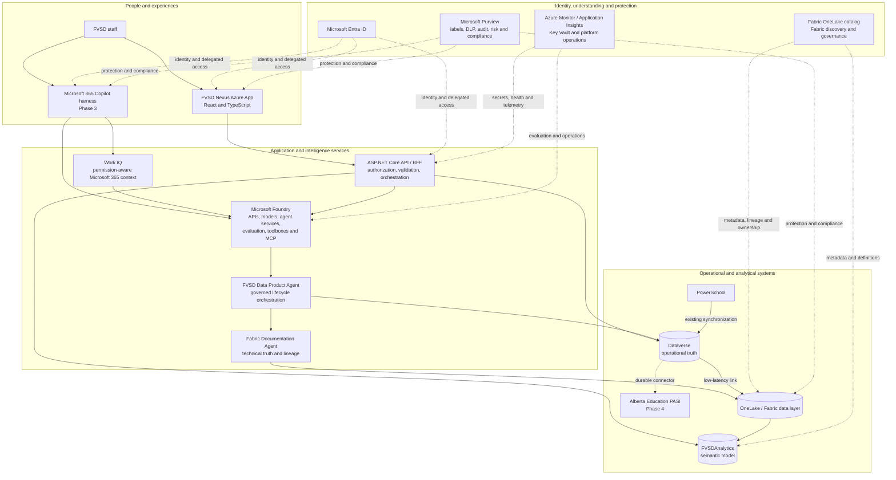

# Architecture overview

> [FVSD Nexus](../../README.md) / [Documentation](../README.md) / [Architecture](README.md) / Overview

## Direction

FVSD Nexus is an Azure-hosted application over FVSD's existing Microsoft data, identity, analytics, and governance platforms. The React and ASP.NET Core application remains the primary operational experience. Microsoft Foundry supplies the API, service, model, evaluation, agent, toolbox, and MCP component plane; it does not replace the application or the authoritative domain systems.

Phase 3 adds the Microsoft 365 Copilot harness and Work IQ as another governed way to reach approved Nexus skills and agents. The same authorization, privacy, audit, and human-confirmation rules apply regardless of entry point.

## Moving parts

The diagram separates three concerns that are easy to blur:

- **Work:** Nexus and, later, Microsoft 365 Copilot are the user experiences.
- **Truth:** Dataverse owns operational records; the Fabric semantic model owns governed analytical calculations.
- **Understanding and protection:** Fabric catalog capabilities describe assets inside Fabric, while Purview supplies broader information-protection and compliance controls. Exact FVSD Purview catalogue usage remains a tenant configuration decision.

## Responsibilities

| Component | Responsibility |
|---|---|
| Nexus React application | Task-oriented UX, context, forms, accessible feedback, and role-aware presentation. |
| ASP.NET Core API | Authentication session, delegated token acquisition, authorization, validation, orchestration, and predefined service queries. |
| Dataverse | Operational records, relationships, reference tables, workflow state, security roles, and audit. |
| Fabric and `FVSDAnalytics` | Analytical data, governed measures, calculations, terminology, lineage, and analytical RLS. |
| Microsoft Foundry | Governed AI and agent runtime components, evaluation, service APIs, toolboxes, and MCP integration. |
| Microsoft 365 Copilot and Work IQ | Phase 3 conversational harness and permission-aware Microsoft 365 context for approved skills and agents. |
| Data Product Agent | Coordinates documented discovery, validation, review, registration, publication, and audit contracts; it is not a student-data source. |
| Fabric Documentation Agent | Retrieves authoritative Fabric technical metadata and lineage for explanation and downstream governance workflows. |
| Purview | Information protection, sensitivity, DLP, audit, risk, and compliance; enterprise catalog use is confirmed separately from source-data access. |
| Entra ID | Named identity, authentication, groups, and delegated access context. |
| Azure operations | Canadian hosting, Key Vault, telemetry, monitoring, deployment, and recovery controls. |

## Trust boundaries

- The browser calls same-origin, purpose-built endpoints and never receives reusable service tokens or arbitrary DAX capability.
- Analytics endpoints map approved questions to predefined DAX; operational endpoints map approved workflows to validated Dataverse reads and writes.
- Agents invoke published tools and contracts. They do not bypass application or destination authorization.
- Work IQ context remains permission-aware and does not turn Copilot access into Dataverse, Fabric, or Purview administration rights.
- Consequential writes and publication actions require deterministic validation and the appropriate human confirmation.
- Dataverse confirms an operational save immediately; Fabric analytics update asynchronously.

## Delivery relationship

- **Phase 1:** Azure App, Fabric integration, Class Assignments, Assessments, and core IEP/IPP.
- **Phase 2:** IEP/IPP expansion and Dossier transition.
- **Phase 3:** Microsoft 365 Copilot harness, Work IQ, Foundry services, agents, skills, and MCP components.
- **Phase 4:** PASI connector.

See the [phased delivery plan](../delivery/roadmap.md) and [ADR-0007](../decisions/adr/0007-azure-app-and-microsoft-foundry.md).

## Compatibility

The source solution is named `FVSDNexus`, while existing deployed Azure resources retain `fvsd-insights` identifiers. Keeping those identifiers avoids infrastructure replacement that provides no product value.
