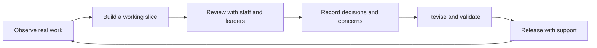

# Adoption and engagement

> [FVSD Nexus](../../README.md) / [Documentation](../README.md) / [Delivery](README.md) / Adoption and engagement

FVSD's implementation strength is not a technology choice. It is the way leadership, educators, operational staff, data specialists, and platform owners work through real problems together. Nexus should preserve that approach as its functional scope grows.

## FVSD approach

1. **Start with real work.** Build from the assessment, annual-plan, intervention, analytics, and reporting work staff already perform.
2. **Show working slices early.** Use representative student and class workflows so educators can react to something concrete.
3. **Reuse trusted definitions.** Keep operational truth in Dataverse and analytical definitions in the governed Fabric semantic model.
4. **Explain before enforcing.** Tell staff what a result means, where it came from, how current it is, and who can correct it.
5. **Keep people in consequential decisions.** Agents may retrieve, explain, validate, and prepare work; staff remain responsible for approval, publication, and student decisions.
6. **Validate in parallel.** Compare Nexus with established systems before retiring a form, report, or vendor workflow.
7. **Turn feedback into visible changes.** Record decisions, adjust the product, and return the result to the people who raised the issue.

## Engagement groups

| Group | Contribution | What Nexus must make clear |
|---|---|---|
| Division leadership | Direction, priorities, risk acceptance, and release approval | Outcomes, adoption, unresolved risk, and investment required |
| Principals and school leaders | School context, completion oversight, and workflow validation | Current status, missing work, data freshness, and escalation path |
| Teachers and specialists | Daily workflow, educational meaning, and usability feedback | What they can act on, why a field is required, and where information will be reused |
| Student services and programme owners | IEP/IPP, intervention, assessment, and policy requirements | Ownership, review points, historical integrity, and document outcomes |
| Data analyst and data stewards | Definitions, quality, lineage, semantic measures, and governed publication | Source, transformation, ownership, freshness, sensitivity, and approval status |
| IT, privacy, security, and records staff | Identity, platform operation, protection, audit, retention, and incident response | System boundaries, data movement, access decisions, and support ownership |

## Governance and understanding

For non-technical audiences, Nexus should introduce governance through practical questions:

- What does this information mean?
- Where did it come from and how current is it?
- Who is responsible for it?
- Who is allowed to see or change it?
- What happens when it is wrong or incomplete?
- Which decision still requires a person?

The formal governance controls remain important, but the interface and training should lead with understanding. A user should not need to know Purview terminology to recognize an owner, a definition, a freshness warning, or a restricted action.

## Feedback cycle

## Adoption evidence

Adoption should be measured using a small set of meaningful signals:

- completion and correction rates for the workflow;
- time from missing information to resolution;
- use by intended roles and schools;
- support requests, recurring confusion, and accessibility findings;
- agreement between Nexus and authoritative operational or analytical sources;
- user confidence in definitions, freshness, and responsibility;
- safe fallbacks and recovery when an integration is unavailable.

These signals are more useful than page views alone because they show whether Nexus is helping staff complete governed work accurately.
