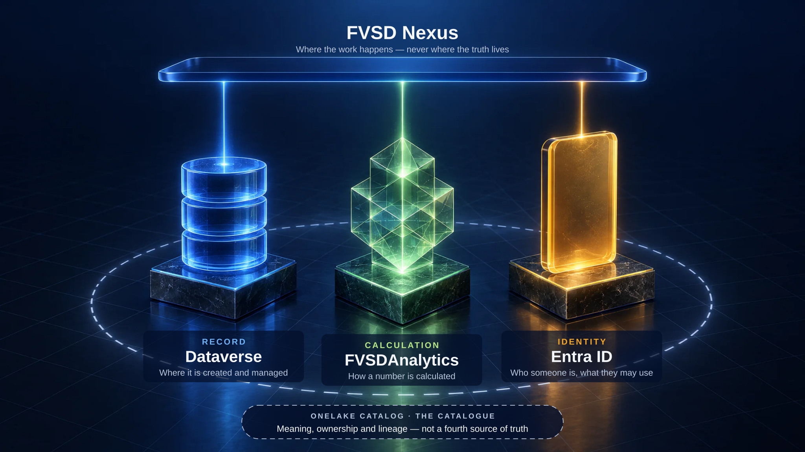

# 🖼️ Asset library and iconography

[🏠 Home](../README.md) › [🎨 Design system](README.md) › Asset library and iconography

This register identifies canonical production assets and exploratory candidates. The linked source file remains the single asset; documentation should not create duplicate production copies.

## 🎨 Current production assets

| Asset | Canonical path | Format / dimensions | Status | Use |
|---|---|---|---|---|
| FVSD Nexus application logo | [`src/FVSDNexus.Web/src/assets/fvsd-nexus-logo.png`](../../src/FVSDNexus.Web/src/assets/fvsd-nexus-logo.png) | PNG, 256 × 256 | Current | Sidebar and application identity. |
| Browser favicon | [`src/FVSDNexus.Web/public/favicon.svg`](../../src/FVSDNexus.Web/public/favicon.svg) | SVG | Current | Preferred scalable browser icon. |
| Browser favicon 32 | [`src/FVSDNexus.Web/public/favicon-32.png`](../../src/FVSDNexus.Web/public/favicon-32.png) | PNG, 32 × 32 | Current | Browser fallback. |
| Browser favicon 48 | [`src/FVSDNexus.Web/public/favicon-48.png`](../../src/FVSDNexus.Web/public/favicon-48.png) | PNG, 48 × 48 | Current | Browser fallback. |
| Apple touch icon | [`src/FVSDNexus.Web/public/apple-touch-icon.png`](../../src/FVSDNexus.Web/public/apple-touch-icon.png) | PNG, 256 × 256 | Current | Installed/mobile shortcut. |
| SVG symbol sheet | [`src/FVSDNexus.Web/public/icons.svg`](../../src/FVSDNexus.Web/public/icons.svg) | SVG sprite | Current | Existing application symbols. |

## 🎨 Confirmed replacement assets

| Asset | Path | Status | Decision required |
|---|---|---|---|
| New scalable FVSD Nexus menu logo supplied November 12, 2026 | [`assets/approved/fvsd-nexus.svg`](assets/approved/fvsd-nexus.svg) | Confirmed; used in the local shell prototype | Replace the current raster production menu mark after the Stage 3 shell is approved; compact-rail sizing is available for review. |
| New FVSD Nexus favicon supplied November 12, 2026 | [`assets/approved/fvsd-nexus-favicon.png`](assets/approved/fvsd-nexus-favicon.png) | Confirmed; production implementation pending | Replace the current favicon set and generate required derivative sizes during implementation. |

The supplied logo confirms the asset, not the use of its bright blue as the general application action colour. That remains a separate design-token decision.

## 🎨 Interface icons

`lucide-react` is the current interface-icon dependency and should be the default icon source.

Proposed icon rules:

- Use outline icons from one family rather than mixing visual styles.
- Default stroke follows the Lucide component default unless an approved component contract overrides it.
- Pair an icon with text for primary or unfamiliar actions.
- Every icon-only button requires an accessible name and a visible tooltip where the meaning is not otherwise present.
- Do not use a red icon for a neutral alternate state.
- File-type icons may use recognizable PDF, Word, Excel and image treatments, but must also include a text file type or filename.
- Navigation icons identify destinations; status dots and badges communicate attention separately.

## 🖼️ Documentation illustrations

Architecture illustrations combine generated, **textless** art with an editable label layer. The words, positions and accessible description live in `<name>.labels.svg`; `npm run docs:illustrations` composes them with `<name>.base.webp` into a self-contained `<name>.svg`. The Mermaid diagram on the same page remains the precise reference; the illustration is its presentation form. Style rules are in [Brand and voice](../standards/brand-and-voice.md#-imagery).

| Illustration | Files | Generated with | Status | Used on |
|---|---|---|---|---|
|  Three sources of truth | [`illustrations/three-sources-of-truth.*`](assets/illustrations/) | OpenArt · GPT Image 2.5 Sunburst · 2K 16:9 high · 2026-11-17 (history `I4Vbg9682I5YgzQAcuNV`) | 🟢 **Current** | [Documentation home](../README.md), [Philosophy](../philosophy/README.md) |

Prompt: Three sources of truth (house style A)

Isometric 3D architectural concept illustration, dark premium technology aesthetic. Deep navy background (#04102B) with a faint perspective grid floor fading into darkness and a soft radial glow of steel blue (#1F4E79) behind the scene. Centre of the composition: three separate stone-and-glass plinths standing side by side in a gentle arc on the grid floor, evenly spaced, each a different shape and colour. LEFT plinth: a stack of three glowing translucent sapphire-blue database cylinders (#1F4E79 with cyan #4A90E2 edge light), representing stored records. CENTRE plinth: a faceted crystalline lattice in fresh mint green (#B8E986) with fine geometric internal lines, representing calculation. RIGHT plinth: a tall rounded rectangular monolith shaped like an access card, warm amber gold (#F5A623) with a soft inner glow, representing identity. Above all three, floating, a single sleek horizontal deep-navy glass platform with a cyan rim light (#4A90E2), connected to each plinth below by a thin vertical beam of light in that plinth's colour. Surrounding the three plinths at floor level, a large translucent dashed ring of pale blue-grey light (#B9C6DC) like a soft halo, clearly separate and not touching the plinths. Clean, minimal, generous negative space above each plinth and around the edges for labels to be added later. Cinematic soft lighting, subtle reflections on the floor, high detail, crisp edges. Absolutely no text, no letters, no numbers, no logos, no icons with writing, no people.

## 🧪 Asset acceptance checklist

Before an asset becomes Current:

1. Confirm ownership and permitted use.
2. Confirm intended light, dark, compact and print contexts.
3. Verify legibility at its smallest production size.
4. Provide accessible alternative text or mark it decorative.
5. Optimize file size and remove unnecessary metadata.
6. Record its canonical path and replacement impact here.

---

*🏫 FVSD Nexus · Fort Vermilion School Division · Design system*
