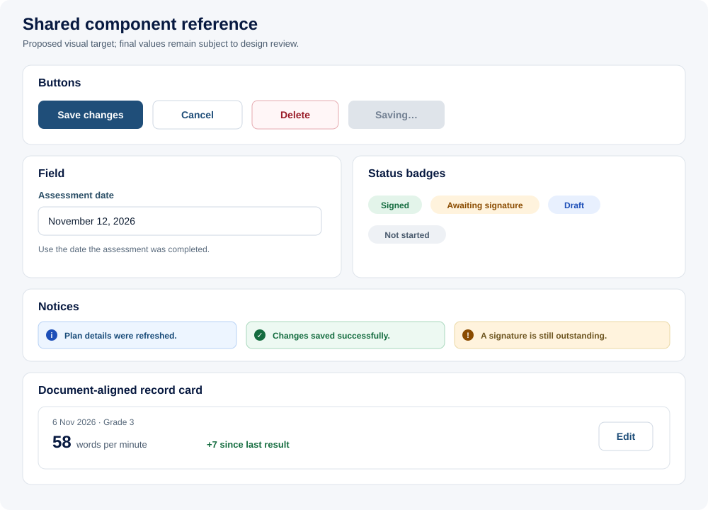

# Rendered component gallery

> [FVSD Nexus](../../README.md) / [Documentation](../README.md) / [Design system](README.md) / Component gallery

**Status:** Proposed visual targets

Each example pairs implementation-shaped markup with a rendered SVG reference so the appearance remains visible in GitHub Markdown and other documentation viewers that remove custom CSS from raw HTML.



The examples use target class names. They are not yet production components.

## Buttons

```tsx
<Button variant="primary">Save changes</Button>
<Button variant="secondary">Cancel</Button>
<Button variant="dangerSoft">Delete</Button>
<Button variant="primary" busy disabled>Saving…</Button>
```

Equivalent semantic HTML:

```html
<button class="ui-button ui-button--primary">Save changes</button>
<button class="ui-button ui-button--secondary">Cancel</button>
<button class="ui-button ui-button--danger-soft">Delete</button>
<button class="ui-button ui-button--primary" disabled aria-busy="true">Saving…</button>
```

## Field

```tsx
<Field
  label="Assessment date"
  helperText="Use the date the assessment was completed."
>
  <input type="date" name="assessmentDate" />
</Field>
```

Equivalent semantic HTML:

```html
<div class="ui-field">
  <label for="assessment-date">Assessment date</label>
  <input id="assessment-date" type="date" aria-describedby="assessment-date-help">
  <small id="assessment-date-help">Use the date the assessment was completed.</small>
</div>
```

## Status badges

```tsx
<StatusBadge tone="success">Signed</StatusBadge>
<StatusBadge tone="warning">Awaiting signature</StatusBadge>
<StatusBadge tone="info">Draft</StatusBadge>
<StatusBadge tone="neutral">Not started</StatusBadge>
```

Status text is always present; colour is supplementary.

## Notices

```tsx
<Notice tone="info">Plan details were refreshed.</Notice>
<Notice tone="success">Changes saved successfully.</Notice>
<Notice tone="warning">A signature is still outstanding.</Notice>
```

## Document-aligned record card

```tsx
<PlanRecordCard
  date="2026-11-06"
  context="Grade 3"
  value="58"
  unit="words per minute"
  change="+7 since last result"
  onEdit={openEditor}
/>
```

The same view model can render a compact card on a narrow screen, a table row on desktop, and a non-interactive record in the compiled document. Edit controls exist only in screen mode.

## Gallery maintenance

When a component is approved:

1. Update its status and exact token values in the canonical component/foundation document.
2. Update the rendered SVG reference.
3. Add or update the real React component example.
4. Confirm the implementation through accessibility and visual-regression tests.
