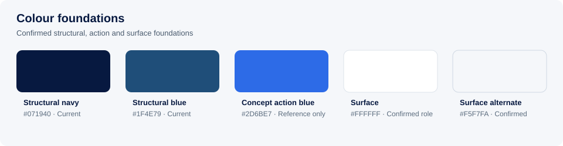
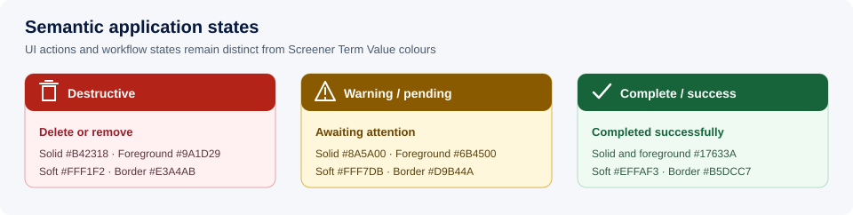

# Foundations and design tokens

> [FVSD Nexus](../../README.md) / [Documentation](../README.md) / [Design system](README.md) / Foundations

This document records the semantic visual foundations confirmed on November 13, 2026. It distinguishes current production values from the approved consolidation target that Stage 2 will implement.



## Colour

### Current brand and governed data colours

| Role | Value | Status | Notes |
|---|---:|---|---|
| Structural navy | `#071940` | Current | Primary FVSD Nexus structural colour. |
| Structural blue | `#1F4E79` | Confirmed | Active navigation and default application action/focus basis. |
| Structural tertiary | `#666666` | Current | Legacy secondary text token; semantic text tokens will replace direct use. |
| Screener Term Value 1–7 | `#FF0000`, `#ED7D31`, `#FFC000`, `#92D050`, `#00B050`, `#5B7BD6`, `#071940` | Current | Governed screener/descriptive-term sequence; never used for application actions or workflow status. |
| Divergent minimum/maximum | `#9DB0E6`, `#F4B183` | Current | Analytics-specific scale. |
| Concept action blue | `#2D6BE7` | Reference only | Retained with the exploratory artboards; not approved as an application default. |

### Confirmed semantic roles

Implementation should use role names rather than raw colour literals:

- `brand-strong`, `brand`, `action`, `action-hover`, `focus`
- `text-strong`, `text`, `text-muted`, `text-on-dark`
- `surface`, `surface-alt`, `surface-sunken`, `surface-overlay`
- `border`, `border-strong`
- `info`, `success`, `warning`, `danger`, each with foreground, background and border roles
- `data-*`, `sentiment-*`, and `descriptive-term-*` as governed palettes separate from application chrome

**Rule:** descriptive-term and chart colours must not be repurposed for buttons, notices, or navigation.

### Semantic application states



Application states use separate steps for solid actions, readable foregrounds, soft surfaces and borders. None of these values duplicate the governed Screener Term Value colours.

| Semantic role | Intended meaning | Solid action | Foreground/icon | Soft background | Border | Status |
|---|---|---:|---:|---:|---:|---|
| Destructive / danger | Delete, remove, destructive confirmation, failed or cancelled state | `#B42318` | `#9A1D29` | `#FFF1F2` | `#E3A4AB` | Confirmed |
| Warning / pending | Attention required, awaiting action, incomplete review or expiring state | `#8A5A00` | `#6B4500` | `#FFF7DB` | `#D9B44A` | Confirmed |
| Complete / success | Complete, signed, saved or successfully submitted state | `#17633A` | `#17633A` | `#EFFAF3` | `#B5DCC7` | Confirmed |

Usage by component:

- solid destructive, warning or success buttons use the solid-action colour with white text and icons;
- soft buttons, chips and notices use the semantic foreground, soft background and border together;
- standalone semantic icons use the foreground/icon colour, not the bright Screener Term Value colour;
- colour is always accompanied by an icon, label or other text-supported state;
- a neutral unchecked, excluded or disabled state remains neutral unless it represents a genuine warning or destructive outcome.

The confirmed foreground/background and white/solid pairs meet WCAG AA contrast for normal text. Bright yellow is not used for text or an icon on white; the warning foreground is a darker amber while the soft surface supplies the yellow family cue.

```css
:root {
  --state-danger-solid: #b42318;
  --state-danger-foreground: #9a1d29;
  --state-danger-background: #fff1f2;
  --state-danger-border: #e3a4ab;

  --state-warning-solid: #8a5a00;
  --state-warning-foreground: #6b4500;
  --state-warning-background: #fff7db;
  --state-warning-border: #d9b44a;

  --state-success-solid: #17633a;
  --state-success-foreground: #17633a;
  --state-success-background: #effaf3;
  --state-success-border: #b5dcc7;
}
```

## Typography

| Foundation | Confirmed target | Status |
|---|---|---|
| Font family | `"Segoe UI", system-ui, -apple-system, "Helvetica Neue", Arial, sans-serif` | Confirmed |
| Weights | 400, 600, 700 | Confirmed |
| Body text | 14 px | Confirmed |
| Secondary text | 13 px | Confirmed |
| Compact metadata and labels | 12 px minimum | Confirmed |
| Form controls | 14 px desktop; 16 px on touch layouts | Confirmed |
| Headings | 16, 20, 24 and 32 px semantic levels | Confirmed |

Seven-to-ten-pixel text is not an accepted target for required content. Uppercase labels should be used sparingly and remain readable without excessive letter spacing.

## Spacing

**Confirmed scale:** `4, 8, 12, 16, 20, 24, 32, 48` px.

Components should use this scale for gaps, padding, and section rhythm. Optical exceptions must be documented in the component contract rather than introduced as arbitrary one-off values.

## Shape

| Token | Value | Intended use |
|---|---:|---|
| Radius small | 6 px | Compact controls and small inline actions. |
| Radius control | 8 px | Buttons, fields, tabs and navigation items. |
| Radius panel | 12 px | Cards, panels, drawers and dialogs. |
| Radius pill | 999 px | Status chips only. |

These are Confirmed consolidation targets. Circular avatars and indicators may use `50%`.

## Elevation

The confirmed system has four semantic levels using a single navy-derived shadow base:

| Level | Token value | Use |
|---|---|---|
| None | `none` | Most cards; border provides structure. |
| Small | `0 2px 6px rgba(7, 25, 64, 0.10)` | Raised interactive card or active control. |
| Medium | `0 8px 24px rgba(7, 25, 64, 0.16)` | Menus and pinned panels. |
| Large | `0 18px 48px rgba(7, 25, 64, 0.22)` | Drawers, dialogs and modal overlays. |

Browser review may adjust rendering defects through change control. Glossy or decorative inset effects are not general-purpose elevation.

## Controls and focus

- Desktop control target: 36–40 px depending on density.
- Touch control target: at least 44 px.
- Phone primary action: at least 48 px.
- One visible `:focus-visible` treatment must cover every interactive element.
- Disabled controls must be visually distinct and retain readable labels.
- Status may never be communicated by colour alone.

The focus basis is structural blue `#1F4E79`. On light and dark surfaces, a two-step ring uses a white separation ring plus structural blue so focus remains visible without changing component geometry.

## Responsive foundations

The current application has page-specific breakpoints. The confirmed Nexus viewport breakpoints align with the existing Power Apps model:

`600, 900, 1200, 1400` px

These produce five named viewport bands. They coordinate the application shell; components also use container queries when drawers or split panels reduce their actual available width. See [Responsive behaviour and breakpoints](responsive.md) for the full matrix, typography rules, and implementation examples.

## Screen and document relationship

Screen and compiled-document renderers share semantic content rules, not necessarily identical geometry. Shared rules include:

- section title and description;
- labels, date formats and missing-value conventions;
- value and descriptive-term formatting;
- table and record-card hierarchy;
- banner and status meaning;
- module order and inclusion state.

The document renderer owns page size, page breaks, running headers and footers, table continuation, contents pages, appendices, and signature placement. Interactive controls are never rendered into the compiled document.
