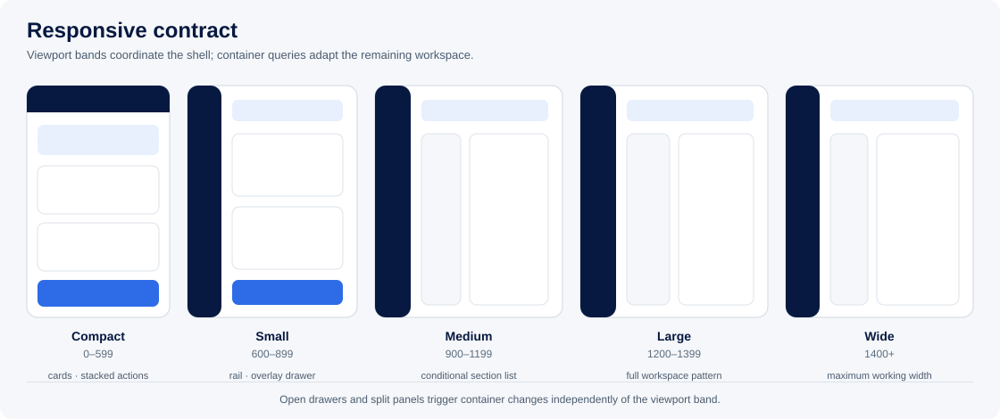

# Responsive behaviour and breakpoints

> [FVSD Nexus](../../README.md) / [Documentation](../README.md) / [Design system](README.md) / Responsive behaviour

**Status:** Confirmed contract — November 13, 2026

FVSD Nexus uses viewport breakpoints to coordinate the application shell and container queries to adapt individual workspaces. This mirrors the intent of the existing Power Apps size/orientation logic without shrinking required content below accessible reading sizes.



## Viewport bands

The confirmed breakpoint values are:

`[600, 900, 1200, 1400]`

| Band | Viewport width | Primary use |
|---|---:|---|
| Compact | 0–599 px | Phone and narrow window. |
| Small | 600–899 px | Large phone, small tablet and split window. |
| Medium | 900–1199 px | Tablet landscape and compact desktop. |
| Large | 1200–1399 px | Standard desktop. |
| Wide | 1400 px and above | Wide desktop and high-density workspaces. |

Breakpoints are inclusive at their lower bound. Tests must cover both sides of every boundary.

## Fluid sizing first

The layout is fluid between breakpoints. Breakpoints do not assign a fixed page width; they change the composition when the available space can no longer support the current arrangement.

Use these sizing rules:

- page, workspace and content regions consume `100%` of the space offered by their parent;
- CSS Grid fractional units (`fr`) and `minmax(0, 1fr)` divide remaining width more reliably than chains of percentage widths;
- flexible panels may use `%`, `vw`, `dvw`, `clamp()` and documented minimum/maximum widths;
- vertical shells use `min-height: 100dvh`, then Grid/Flex growth, rather than percentage heights with no definite parent height;
- the root application shell uses exactly the visible dynamic viewport height and prevents browser-document scrolling;
- scrollable workspace regions use `min-height: 0`, `min-width: 0` and explicit scroll ownership;
- controls retain minimum target sizes and readable text even when their surrounding container is fluid;
- document/PDF output retains fixed page geometry because it is a print surface, not an application viewport.

Percentage sizing alone does not determine when a table should become cards, a navigation menu should collapse, or a full label should change to its compact form. The responsive bands and container states still control those structural changes.

Avoid fixed pixel widths for main content. Fixed or bounded values remain appropriate for touch targets, icons, borders, the compact navigation rail, and panels that would otherwise become too narrow or too wide to use.

## Application response matrix

| Concern | Compact | Small | Medium | Large | Wide |
|---|---|---|---|---|---|
| Navigation | Menu trigger opens a full-height overlay navigation | Collapsed rail; overlay when the rail cannot remain usable | Bounded compact rail in workspaces | Expanded on standard pages; rail in workspaces | Expanded on standard pages; rail in workspaces |
| Context filters | Bottom sheet or near-full overlay | Overlay drawer | Overlay drawer | Overlay drawer; pin available after validation | Overlay or pinned drawer when content remains usable |
| Page header | Single compact row; secondary text moves below or hides visually | Compact title and actions | Compact workspace header | Full standard header or compact workspace header | Full standard header or compact workspace header |
| IEP/IPP sections | Select plus previous/next | Select plus previous/next | Vertical list when its container permits; otherwise select | Vertical collapsible list | Vertical collapsible list |
| Forms | One column; primary action full width | One column or two where fields remain usable | Two-column groups | Two- or three-column groups | Two- or three-column groups |
| Tables | Priority fields become cards; optional horizontal scroll for data comparison | Cards or reduced-column table | Table with lower-priority columns hidden by container | Full table | Full table with increased working width |
| Action labels | Full label where possible; icon-only only with accessible name | Short label permitted | Standard label | Full label | Full label |
| Descriptions | Essential description retained; repeated guidance collapsible | Repeated guidance collapsible | Standard description | Full description | Full description |

The matrix defines intended outcomes, not blanket CSS hiding. Each component contract identifies which information is essential and which has a shorter representation.

## Component container states

Viewport size alone is insufficient. A 1400 px viewport can leave a module with less than 800 px after the rail, context drawer and document panel are open.

The initial workspace container states are:

| Available component width | State | Typical changes |
|---|---|---|
| Below 720 px | Narrow | Section selector replaces side list; tables become cards/reduced columns; actions stack; compact labels display. |
| 720–999 px | Standard | Table layout where viable; section list may collapse; descriptions shorten; two-column forms permitted. |
| 1000 px and above | Spacious | Persistent section list, full labels/descriptions and wide goal/table layouts. |

These thresholds are component-level starting points and may be refined through the IEP/IPP prototype. A chart or goal matrix may define its own named container query when the visual cannot sensibly follow the generic table rule.

## Typography by responsive state

Required information does not become less readable on smaller screens. Layout and content priority change before font size.

| Role | Compact / Small | Medium / Large / Wide |
|---|---:|---:|
| Body | 14 px | 14 px |
| Secondary text | 13 px | 13 px |
| Metadata / data label | 12 px minimum | 12 px minimum |
| Form control text | 16 px | 14 px |
| Section heading | 20 px | 20 px |
| Page/workspace title | `clamp(24px, 5vw, 28px)` | `clamp(28px, 2.4vw, 32px)` |

The 16 px compact form-control size prevents unwanted mobile-browser zoom. Six-to-ten-pixel sizes from the Power Apps example are not carried into Nexus web content.

## Buttons and action width

The Power Apps global button widths become semantic CSS behaviours rather than fixed widths everywhere:

| Action | Narrow behaviour | Standard/spacious behaviour |
|---|---|---|
| Primary page/form action | Full width when isolated | Content width, minimum 140 px |
| Secondary page action | Full width or paired equal columns | Content width, minimum 100 px |
| Row action | Text button when space permits; menu if several actions | Compact text button |
| Icon-only action | Minimum 44 × 44 px and accessible name | Minimum 36 × 36 px and tooltip |

Text must not be truncated merely to preserve a fixed button width. Use a shorter approved label or allow the control to grow.

## Full and compact labels

When a shorter label is needed, both values are intentional content rather than text sliced with JavaScript. The accessible name remains complete.

```tsx
<Button aria-label="Manage plan sections">
  <Layers aria-hidden="true" />
  <span className="label-full">Manage sections</span>
  <span className="label-compact" aria-hidden="true">Sections</span>
</Button>
```

```css
.label-compact { display: none; }

@container workspace (max-width: 720px) {
  .label-full { display: none; }
  .label-compact { display: inline; }
}
```

Course and section names should use explicit `fullLabel`, `shortLabel`, and optional `code` values from the presentation model where possible. Responsive presentation should not repeatedly parse display strings such as text inside parentheses.

## CSS implementation pattern

```css
html,
body,
#root {
  block-size: 100%;
  margin: 0;
  overflow: hidden;
}

/* The shell stays inside the visible viewport. */
.app-shell {
  inline-size: 100%;
  block-size: 100dvh;
  overflow: hidden;
  display: grid;
  grid-template-rows: auto minmax(0, 1fr);
}

.app-body {
  min-inline-size: 0;
  min-block-size: 0;
  overflow: hidden;
}

/* Branding and account controls remain visible; only destinations scroll. */
.navigation {
  block-size: 100%;
  min-block-size: 0;
  overflow: hidden;
  display: grid;
  grid-template-rows: auto minmax(0, 1fr) auto;
}

.navigation__destinations {
  min-block-size: 0;
  overflow-y: auto;
  overscroll-behavior: contain;
  scrollbar-gutter: stable;
}

/* Bounded chrome plus a fully fluid work area. */
.workspace-shell {
  inline-size: 100%;
  min-inline-size: 0;
  min-block-size: 0;
  display: grid;
  grid-template-columns:
    clamp(4rem, 5vw, 4.5rem)
    minmax(0, 1fr);
}

.workspace-main {
  inline-size: 100%;
  min-inline-size: 0;
  min-block-size: 0;
  overflow: auto;
  overscroll-behavior: contain;
}

.context-drawer {
  inline-size: clamp(20rem, 30vw, 28rem);
  max-inline-size: 100%;
  max-block-size: 100%;
  min-block-size: 0;
  overflow: hidden;
  display: grid;
  grid-template-rows: auto minmax(0, 1fr) auto;
}

.context-drawer__body {
  min-block-size: 0;
  overflow-y: auto;
}

/* Viewport coordination for the application shell. */
@media (min-width: 600px) { /* small */ }
@media (min-width: 900px) { /* medium */ }
@media (min-width: 1200px) { /* large */ }
@media (min-width: 1400px) { /* wide */ }

/* Available-width coordination inside a workspace. */
.workspace {
  container-name: workspace;
  container-type: inline-size;
}

@container workspace (max-width: 719px) {
  .module-table { display: none; }
  .module-cards { display: grid; }
}

@container workspace (min-width: 720px) {
  .module-table { display: table; }
  .module-cards { display: none; }
}
```

Use logical properties such as `inline-size` and `block-size` in shared layout primitives. They express the intended axis and make future localization safer than scattering `width` and `height` rules.

CSS controls visual presentation. React should use `matchMedia` only when the interaction itself changes, such as choosing between an anchored drawer and a modal bottom sheet. Avoid maintaining a JavaScript copy of purely visual conditions.

## Orientation and height

Orientation is a secondary modifier rather than a duplicate breakpoint tree. Width and container space choose the primary layout. Orientation/height rules may:

- reduce nonessential header height in short landscape viewports;
- keep primary actions visible above the on-screen keyboard;
- adjust drawer or dialog maximum height;
- preserve safe areas on mobile devices.

They must not reduce required text below the documented type scale.

The `dvh` unit is used so the shell follows changes to mobile browser chrome and the on-screen keyboard. Persistent controls must remain inside the resulting visible shell; content absorbs the reduced height through its assigned scroll region.

## Verification matrix

Every shared shell and School Administration screen is checked at:

- 390 × 844 phone portrait;
- 599 and 600 px widths;
- 820 × 1180 tablet portrait;
- 899 and 900 px widths;
- 1180 × 820 tablet landscape;
- 1199 and 1200 px widths;
- 1399 and 1400 px widths;
- 1600 × 1000 wide desktop;
- 200% browser zoom;
- drawer/panel closed, open and pinned where supported.

At every size, verification confirms that the root document has no horizontal or vertical scrollbar, all persistent controls remain visible, and each overflow area scrolls only within its assigned shell region.

Functional tests verify that changing presentation does not change authorization, selected context, unsaved form state, record ordering or document inclusion state.
