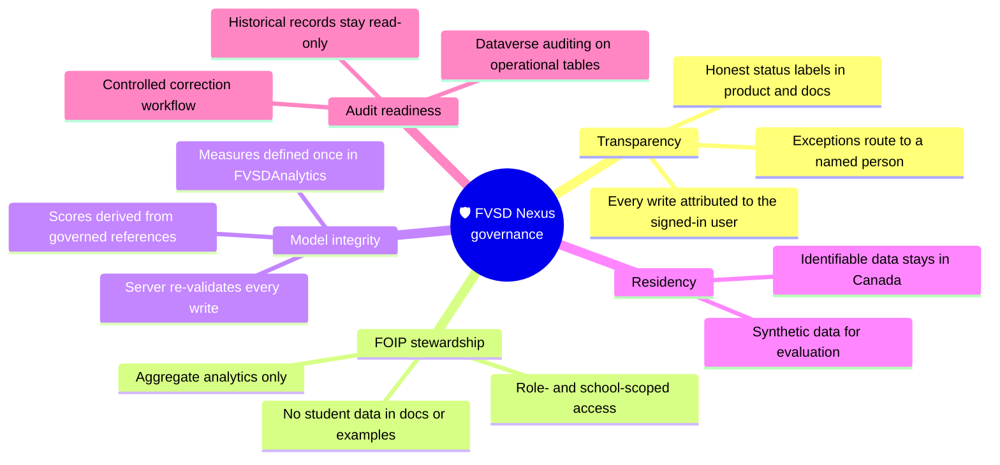

# 🛡️ Governance framework

[🏠 Home](../README.md) › Governance framework

**Status:** 🔵 Confirmed principles. Controls marked 🟢 are implemented in the current build; 🔵 are scheduled; 🟠 are proposed.

FVSD Nexus works with student information under Alberta's FOIP obligations. Governance is therefore built into how Nexus reads, calculates, writes and explains data, rather than added as a policy afterwards. This page brings the controls together and points to the page where each one is specified.

> Governance is not a barrier to self-service. It is the condition that makes self-service possible.

## 🏛️ Principles

## 🔐 Controls

| Control | Status | What it means | Specified in |
|---|---|---|---|
| Named-user delegated access | 🟢 **Current** | Nexus acts as the signed-in person; their own Fabric and Dataverse permissions apply. No pooled service account reads student data. | [Identity, licensing and security](../architecture/identity-licensing-security.md), [ADR-0003](../decisions/adr/0003-named-user-delegated-access.md) |
| Role and school scope | 🟢 **Current** | Class Assignment access, school selection and deletion rights follow the Nexus role record, checked again on the server. | [Assessment entry and scoring](../capabilities/assessments/README.md) |
| Predefined analytics queries | 🟢 **Current** | Only reviewed DAX queries run; no general-purpose query endpoint exists. | [Leadership analytics](../capabilities/leadership-analytics/README.md), [ADR-0002](../decisions/adr/0002-fabric-governed-analytics.md) |
| Governed scoring | 🟢 **Current** | Standard scores and descriptive terms come from reference tables and are re-validated by the API. | [Assessment entry and scoring](../capabilities/assessments/README.md) |
| Period-based editability | 🟢 **Current** | Records outside the current period are read-only; deletion is role-restricted and confirmed. | [Assessment entry and scoring](../capabilities/assessments/README.md) |
| One plan per student per year | 🟢 **Current** | Enforced by the API, not only the interface; a matching Dataverse alternate key is required by the capability design. | [IEP / IPP](../capabilities/ipp/README.md), [ADR-0006](../decisions/adr/0006-modular-annual-student-plans.md) |
| Canadian residency | 🟢 **Current** | Production student information remains in Azure Canada Central and approved Canadian services. | [Residency and platform options](../architecture/residency-and-platform-options.md), [ADR-0004](../decisions/adr/0004-canadian-data-residency.md) |
| Small-group suppression | 🟠 **To define** | Where five or fewer students sit behind a figure it is suppressed, including complementary values that would reveal it. Applied by the FVSD Data Product Agent; Nexus analytics adoption still to be confirmed. | [Data Product Agent FOIP rules](https://github.com/skmckenFVSD/FVSDDataProductAgent/blob/main/docs/governance/foip-compliance.md) |
| Historical correction workflow | 🟠 **Proposed** | Requester, reason, before/after values and approval recorded for any change to a closed record. | [Assessment entry and scoring](../capabilities/assessments/README.md) |
| Purview meaning, ownership and sensitivity | 🔵 **Phase 3** | Governed measures and records carry definitions, owners and sensitivity labels into discovery and AI. | [Purview governance and agent architecture](../architecture/purview-governance.md) |
| Agents act within the person's permissions | 🔵 **Phase 3** | Copilot and Foundry agents explain and prepare; they never grant themselves access or replace the accountable person. | [Copilot and agent interoperability](../architecture/copilot-interoperability.md) |

## 🍁 Residency and AI

- Identifiable student information, including prompts or context derived from it, stays in the approved Canadian geography.
- Preview AI features that would move student-identifiable context outside Canada are not used, however attractive.
- Evaluation of models and agents uses synthetic data unless residency is confirmed.
- Consumption-billed services log every invocation, which supports audit, and each new service clears the same [platform gate](../architecture/residency-and-platform-options.md#-evaluation-gate).

## 📝 Documentation obligations

Governance applies to this documentation too:

- No student names, ASNs, birth dates, emails or real record identifiers in any page, diagram, screenshot or example. Use obfuscated display mode for screenshots.
- No credentials, tenant secrets, connection strings or tokens.
- Status labels must be honest; a proposed control is never described as current.
- A change that alters a control updates this table in the same pull request.

## 🔗 Related documentation

- [Philosophy and design rationale](../philosophy/README.md)
- [Identity, licensing and security](../architecture/identity-licensing-security.md)
- [Purview governance and agent architecture](../architecture/purview-governance.md)
- [FVSD Data Product Agent governance framework](https://github.com/skmckenFVSD/FVSDDataProductAgent/blob/main/docs/governance/README.md)

---

*🏫 FVSD Nexus · Fort Vermilion School Division · Governance*
