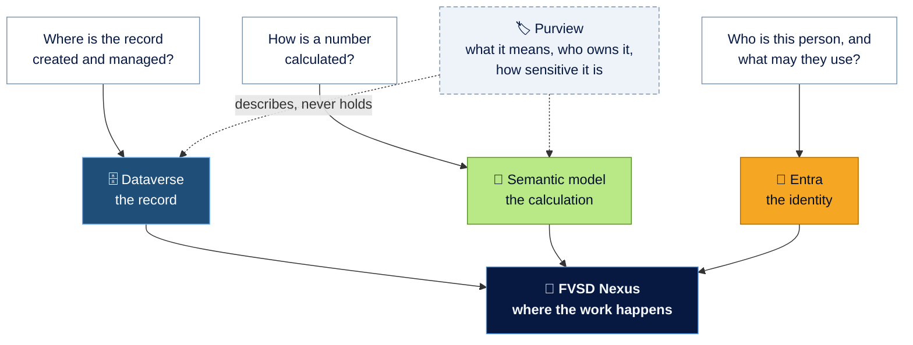

# 📖 Philosophy and design rationale

[🏠 Home](../README.md) › Philosophy and design rationale

> *The app is where the work happens. It is never where the truth lives.*
> — the test every FVSD Nexus decision has to pass

**Status:** 🔵 Confirmed — these principles are reflected in the accepted [architecture decision records](../decisions/adr/README.md).

FVSD Nexus exists because the connective tissue between the division's systems was a person. A learning support teacher preparing for one meeting needed screening scores from one system, enrolment context from another, the current plan from a vendor product and progress notes from wherever they were last written down. Every re-keyed number cost time, and every disagreement between systems cost confidence.

This page explains the principles that answer that problem. They are not slogans: each one is enforced somewhere specific in the architecture, and each one is a test a future change has to pass.

## 🗄️ Three sources of truth

Three questions have three permanent answers. Nothing in Nexus is allowed to become a fourth.

- **Record: Dataverse.** Assessments, plans, reference data, workflow state and the audit history of who changed what, and when. See [ADR-0001](../decisions/adr/0001-dataverse-operational-truth.md).
- **Calculation: the semantic model.** Every measure, trend and classification is defined once in `FVSDAnalytics`. No application recalculates it independently. See [ADR-0002](../decisions/adr/0002-fabric-governed-analytics.md).
- **Identity: Entra.** Who someone is, what they are licensed for and where they work. See [ADR-0003](../decisions/adr/0003-named-user-delegated-access.md).
- **Purview is not a fourth source,** and that distinction is the point. It holds none of the record, the calculation or the identity. It publishes what they *mean*, who owns them and how sensitive they are.

## 🎯 The app asks. It never answers.

Nexus sends only predefined, reviewed queries to the semantic model. The browser is never handed the ability to ask the model anything it likes, and there is no general-purpose query endpoint. Measures stay defined where they are governed; row-level security and permissions follow the individual, never a pooled service account.

The same rule applies to writes. Scores, descriptive terms and periods are derived from governed reference data and validated again by the server. A person never types a standard score.

## 🔄 Vertical slices, not prototypes

One narrow journey built completely earns more trust than a broad demo that only works on stage. Nexus was proved with two slices built end to end on real identity and real permissions (leadership analytics, then class assignment and screening history) before anyone was asked to type a student result into a new system. Each later capability follows the same pattern: identity and scope first, trustworthy reading second, governed writing third.

## 📖 Extract documentation, don't write it

Documentation written separately from the system it describes is already drifting. Where the truth already exists — in the semantic model, in Dataverse configuration, in the code — Nexus documentation points to it or generates from it. This documentation layer follows the same rule: the staff guide and the presentation are built from these markdown sources, and the icon table is generated from its registry.

## ⚖️ Separate deciding from writing

No component should both make a judgement and commit it. Each step hands a validated, typed contract to the next, and no free-form instruction crosses a boundary. When something cannot complete correctly, work stops and a named person reviews it; the system never guesses. The [FVSD Data Product Agent](https://github.com/skmckenFVSD/FVSDDataProductAgent) applies this to governed measures, and Nexus applies it to student records and agents in [Phase 3](../architecture/copilot-interoperability.md).

## 🍁 Residency is a boundary, not a preference

Identifiable student information, including anything student-identifiable used with AI, stays inside the approved Canadian geography. Nexus will not stand up a copy of student data elsewhere to gain early access to a preview tool. Evaluation happens on synthetic data or it does not happen. See [ADR-0004](../decisions/adr/0004-canadian-data-residency.md).

## 🛡️ Governance is the condition for self-service

Governance is not a constraint on self-service; it is the condition that makes it possible. When meaning, ownership and sensitivity travel with every measure and record, staff can act on what they see without a research project. AI then becomes a trustworthy surface over that structure rather than a new source of guesses. See the [governance framework](../governance/README.md).

## 📚 The Decision Engine

Three articles by Scott McKenzie in [The Decision Engine](https://medium.com/the-decision-engine) set out the thinking behind these principles. They were written for the FVSD Data Product Agent and apply equally to Nexus.

| Article | Core insight | Where it shows up in Nexus |
|---|---|---|
| [The Measure Illusion](https://medium.com/the-decision-engine/the-measure-illusion-76174d543139) | Familiarity replaces understanding; a measure nobody owns is not a KPI. | Measures stay in the semantic model; analytics shows governed definitions only. |
| [Stop Writing Documentation. Start Extracting It.](https://medium.com/the-decision-engine/stop-writing-documentation-start-extracting-it-04dd1fc6d8ce) | The model already holds the truth; reveal it instead of retyping it. | Generated guide and deck; links to canonical pages rather than copies. |
| [The Moment Trust Breaks](https://medium.com/the-decision-engine/the-moment-trust-breaks) | Decisions fail where meaning should live but does not. | Purview, honest status labels, named-user access and audit history. |

## 🗺️ Principles to decisions

| Principle | Enforced by | Decision |
|---|---|---|
| Three sources of truth | Dataverse writes, `FVSDAnalytics` queries, Entra sign-in | [ADR-0001](../decisions/adr/0001-dataverse-operational-truth.md), [ADR-0002](../decisions/adr/0002-fabric-governed-analytics.md), [ADR-0003](../decisions/adr/0003-named-user-delegated-access.md) |
| The app asks, never answers | Predefined server-side DAX; server-side scoring validation | [ADR-0002](../decisions/adr/0002-fabric-governed-analytics.md) |
| Residency boundary | Azure Canada Central; no off-shore copies | [ADR-0004](../decisions/adr/0004-canadian-data-residency.md) |
| Modular, governed plans | `fvsd_ippsection` catalogue and allocation contract | [ADR-0006](../decisions/adr/0006-modular-annual-student-plans.md) |
| Intelligence as a service plane | Foundry components behind governed contracts | [ADR-0007](../decisions/adr/0007-azure-app-and-microsoft-foundry.md) |

## 🔗 Related documentation

- [Governance framework](../governance/README.md)
- [Architecture overview](../architecture/overview.md)
- [Conference deck: From Evidence to Action](../presentation/decks/from-evidence-to-action.md)

---

*🏫 FVSD Nexus · Fort Vermilion School Division · Philosophy*
