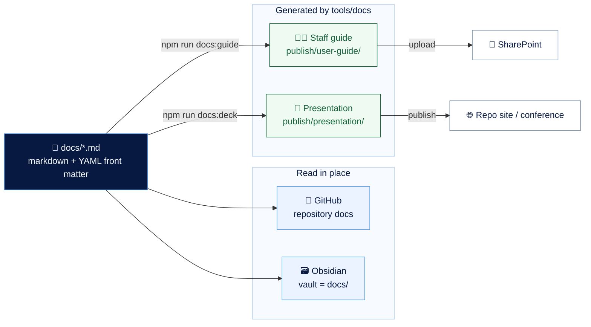

# 📐 Documentation standards

[🏠 Home](../README.md) › Documentation standards

FVSD Nexus documentation is **one markdown source with four surfaces**. Every page is written once, in `docs/`, and read wherever it is needed.



## 💡 Principles

- **Extract, don't duplicate.** A fact lives in one canonical page; everything else links to it. The icon table, the guide and the deck are generated from their sources rather than retyped.
- **Honest status.** Every page declares whether it describes something current, confirmed, proposed or open, and says so again in the body.
- **One visual language.** The same icon means the same thing on GitHub, in Obsidian, in the staff guide and on a conference screen.
- **Written for the reader in front of it.** Architecture pages are precise; staff guide topics are plain, task-first and free of system detail.
- **Safe by default.** No student-level data, credentials, tokens or secrets in any page, screenshot or example.

## 🗺️ The standards

| Standard | What it governs |
|---|---|
| 🎨 [Brand and voice](brand-and-voice.md) | Colour, naming, terminology, spelling and tone across every surface |
| 🧩 [Iconography](iconography.md) | The icon registry: emoji in markdown, Lucide icons in HTML, status markers |
| 🏷️ [Front matter](front-matter.md) | The YAML properties every page carries for Obsidian and the builds |
| 🗺️ [Diagrams](diagrams.md) | Mermaid conventions and the branded class palette |
| 🧑‍🏫 [Writing guide topics](writing-guide-topics.md) | Steps, callouts, screenshots and markers in the staff guide |
| 📝 [Templates](templates/) | Starting points for capability, architecture, ADR, guide-chapter and deck pages |

## 🏗️ Page anatomy

Every documentation page follows the same shape, modelled on the FVSD Data Product Agent repository:

```text
---                                    ← YAML front matter (see Front matter)
title / type / status / icon / tags …
---

# 🏗️ Page title                        ← icon from the registry + sentence-case title

[🏠 Home](…) › [Section](…) › Page     ← breadcrumb

**Status:** 🟢 Current — one line      ← status marker + plain statement

Opening paragraph: what this page is and who it is for.

## 🎯 Section                           ← every H2 starts with a registered icon
…
## 🔗 Related documentation

---

*🏫 FVSD Nexus · Fort Vermilion School Division · Area*   ← footer
```

## 🧪 Checks

Run `npm run docs:check` in `tools/docs/` before committing. It verifies:

- every page has front matter with the required properties and allowed values;
- every heading emoji is in the [icon registry](icon-registry.yml);
- every relative link resolves;
- the generated guide and deck build without errors;
- which staff-guide screenshots are still missing.

---

*🏫 FVSD Nexus · Fort Vermilion School Division · Documentation standards*
