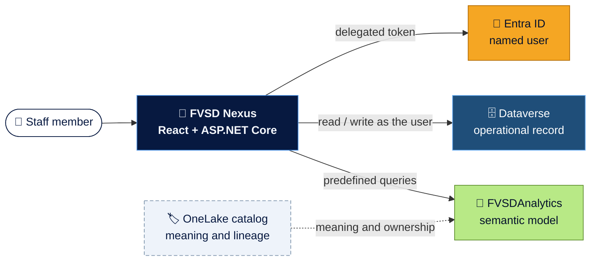

# 🗺️ Diagrams

[🏠 Home](../README.md) › [📐 Standards](README.md) › Diagrams

**Status:** 🔵 Confirmed — use for every new diagram; existing diagrams adopt it when next edited.

Diagrams are written in [Mermaid](https://mermaid.js.org) inside the page, so they render on GitHub and in Obsidian, are reviewed with the text and never drift from a separate image file.

## 💡 When to draw

| Use | Mermaid type | Example |
|---|---|---|
| System structure, trust boundaries, ownership | `flowchart` with `subgraph` | [Architecture overview](../architecture/overview.md) |
| A request or integration sequence | `sequenceDiagram` | Sign-in and delegated token flow |
| A record's lifecycle | `stateDiagram-v2` | Assessment period: open → closed → correction |
| Principles and their parts | `mindmap` | [Governance framework](../governance/README.md) |
| Phases and timing | `timeline` or `gantt` | [Phased delivery plan](../delivery/roadmap.md) |

Draw one idea per diagram. If a diagram needs a paragraph to explain its legend, split it.

## 🎨 Class palette

Copy these `classDef` lines into a flowchart and assign classes, rather than inventing colours. They follow the [brand palette](brand-and-voice.md#-palette), and the three sources of truth keep their colours everywhere.

```text
classDef nexus    fill:#071940,stroke:#4A90E2,color:#F4F7FC,font-weight:bold
classDef record   fill:#1F4E79,stroke:#6FB1F5,color:#FFFFFF
classDef calc     fill:#B8E986,stroke:#5E8F2E,color:#04102B
classDef identity fill:#F5A623,stroke:#B26A00,color:#04102B
classDef catalog  fill:#EEF3FA,stroke:#7B92AA,color:#071940,stroke-dasharray:5 3
classDef surface  fill:#EAF3FF,stroke:#4A90E2,color:#071940
classDef external fill:#FFFFFF,stroke:#7B92AA,color:#071940
classDef person   fill:#FFFFFF,stroke:#071940,color:#071940
classDef done     fill:#EFFAF3,stroke:#17633A,color:#17633A
classDef risk     fill:#FFF1F2,stroke:#B42318,color:#9A1D29
```

| Class | Use for |
|---|---|
| `nexus` | FVSD Nexus itself: the application, API, orchestrators |
| `record` | Dataverse and other operational records |
| `calc` | The `FVSDAnalytics` semantic model and governed measures |
| `identity` | Entra ID, roles, licences |
| `catalog` | The OneLake catalog: meaning, ownership, endorsement, lineage (never a source of truth). Purview protection uses `external` with a 🔐 label. |
| `surface` | Places people work: Copilot, Teams, SharePoint, the browser |
| `external` | PowerSchool, PASI, vendors, Microsoft services outside FVSD control |
| `person` | People and roles |
| `done` | Completed or current states and outputs |
| `risk` | Failure paths, exceptions, blocked states |

Style subgraphs too, so groups never fall back to Mermaid's default yellow:

```text
style GROUP_ID fill:#F7FAFF,stroke:#B7D3F2,color:#071940     %% primary group
style GROUP_ID fill:#FFFFFF,stroke:#D7E4F2,color:#526477     %% secondary group
```

## 📝 Example



## 📐 Conventions

- **Labels:** an icon, a name, then a short role on a second line (`<br>`), for example `"🗄️ Dataverse<br>operational record"`.
- **Edges:** label with the verb or the contract (`delegated token`, `compiled_payload`). Dashed edges (`-.->`) for informational or optional relationships.
- **Direction:** `LR` for flows and integrations, `TD` for hierarchies and lifecycles.
- **No secrets or identifiers:** never put tenant IDs, URLs with tokens, GUIDs or student data in a diagram.
- **Dark mode:** the palette sets explicit text colours so diagrams read on GitHub's light and dark themes.

---

*🏫 FVSD Nexus · Fort Vermilion School Division · Documentation standards*
