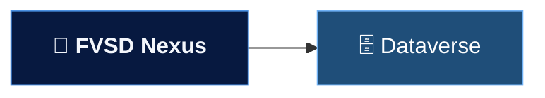

# 🏗️ {{title}}

[🏠 Home](../README.md) › [🏗️ Architecture](README.md) › {{title}}

**Status:** 🟠 Proposed — one line.

## 🎯 Architectural intent

## 🗺️ Components and responsibilities

## 🔐 Security and privacy boundaries

## 🔄 Reliability behaviour

## 🧪 Contract and test requirements

## ⚠️ Explicit exclusions

## 🔗 Related documentation

---

*🏫 FVSD Nexus · Fort Vermilion School Division · Architecture*
