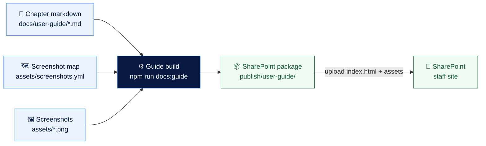

# 🧑‍🏫 FVSD Nexus staff user guide

[🏠 Home](../README.md) › Staff user guide

This folder is the **single source** of the FVSD Nexus staff guide. Staff never read these files directly: the guide build turns them into one self-contained HTML guide that you upload to SharePoint, exactly like the Education Framework Application guide.

> [!IMPORTANT]
> Update the guide **in the same change** that alters a screen, label or rule in the app. The markdown is reviewed with the code; the HTML is rebuilt from it.

## 🗺️ Chapters

| # | Chapter | Covers | Who it is for |
|---|---|---|---|
| 1 | [Getting started](01-getting-started.md) | Signing in, navigation, roles and what is coming | Everyone |
| 2 | [Leadership analytics](02-leadership-analytics.md) | Analysis context, focus area, signals, school comparison, charts | Executive, school leaders |
| 3 | [Class Assignments](03-class-assignments.md) | Finding a class and student, section groups, the student record | Teachers, school administration, support staff |
| 4 | [Assessments](04-assessments.md) | Assessment history, adding, editing and deleting TOSREC, completion monitoring | Teachers, school administration |
| 5 | [IEP / IPP annual plans](05-iep-ipp.md) | Plan history, creating a plan, modules, plan sections, documents | Foundations and homeroom teachers, school administration |
| 6 | [Settings and support](06-settings-and-support.md) | Your role and assignment, connections, reconnecting, getting help | Everyone |

Before publishing, work through the [review notes](review-notes.md). They list everything this draft could not confirm from the code alone.

## 🔄 How the guide is built

1. Edit a chapter. Each `##` heading becomes one guide topic; its first paragraph becomes the topic introduction.
2. Add or replace screenshots in [`assets/`](assets/) and describe them, with any numbered markers, in [`assets/screenshots.yml`](assets/screenshots.yml).
3. Run `npm run docs:guide` from `tools/docs/`. The guide is written to `publish/user-guide/index.html` with its `assets/` folder.
4. Upload `index.html` and `assets/` together to the SharePoint location, keeping the folder name.

The writing conventions (steps, callouts, screenshots and markers) are in [Writing guide topics](../standards/writing-guide-topics.md).

---

*🏫 FVSD Nexus · Fort Vermilion School Division · Staff user guide*
